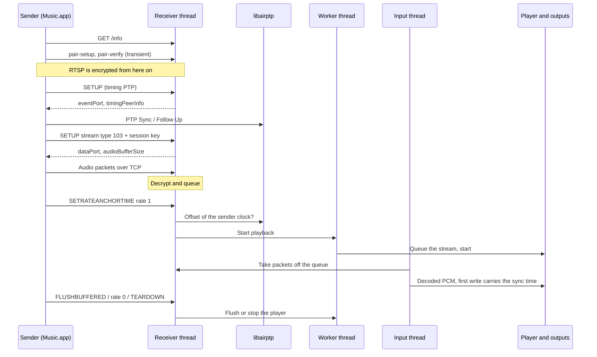

# AirPlay 2 receiver (RX)

OwnTone can appear on the network as an AirPlay 2 speaker. Music.app on a
Mac, or an iPhone, then streams to OwnTone directly, and OwnTone plays the
audio on the speakers selected in OwnTone. This replaces the older setup in
which an external receiver such as Shairport Sync writes the audio into a
pipe that OwnTone reads.

The sending side, where OwnTone streams to AirPlay speakers, is described in
[AirPlay 2 sender (TX)](sender.md).

!!! warning "Work in progress"

    The receiver plays buffered AirPlay 2 streams, which is what Music.app
    uses. Realtime streams are accepted but stay silent. See
    [Limitations](#limitations).

## Quick start

Add this to `owntone.conf` and restart OwnTone:

```conf
airplay_receiver {
	enabled = true
	name = "OwnTone Office"
}
```

The receiver then shows up in the AirPlay menu of Music.app and in Control
Centre on an iPhone. No PIN is needed. Pick it, press play, and OwnTone plays
the stream on whatever speakers are selected in OwnTone.

| Option      | Default              | Meaning                                                                 |
| ----------- | -------------------- | ----------------------------------------------------------------------- |
| `enabled`   | `false`              | Turns the receiver on                                                   |
| `name`      | `"OwnTone"`          | Name shown to senders                                                   |
| `port`      | `7000`               | RTSP port the receiver listens on                                       |
| `device_id` | MAC of the first NIC | Identity of the receiver. Its pairing key is derived from it, so keep it stable |

OwnTone never adds its own receiver as an output. Both the AirPlay 2 and the
AirPlay 1 output modules skip a speaker whose name matches `name`.

## What happens when a sender streams

- **Playback starts on the sender's anchor.** The stream replaces the queue,
  as pipe autostart does. The queue item is called "AirPlay from" followed by
  the sender's name.
- **Pause, skip and seek are immediate.** OwnTone drops what it has already
  buffered, so the change is heard within about 0.3 s. Playback resumes on its
  own when the next anchor arrives.
- **Removing OwnTone from the group stops playback right away.** It does not
  play out the buffer first.
- **The sender's volume sets OwnTone's volume.** The sender sends dB from -30
  to 0, which maps linearly to 0 to 100, and -144 means mute. This is the same
  mapping the pipe input uses for Shairport Sync's `pvol`.
- **Audio is timed to the sender's clock.** OwnTone plays each frame at the
  time the sender asked for, so it stays in step with the other speakers the
  sender is grouping. If that time has already passed, OwnTone starts as soon
  as it can and logs how late it was.

## Monitoring

**Settings > Performance** in the web interface has a receiver card. It shows
whether a sender is streaming, packet counts and the sender clock as OwnTone
sees it. The same figures are in the `receiver` object of `GET /api/stats`:

| Field                   | Meaning                                                        |
| ----------------------- | -------------------------------------------------------------- |
| `streaming`, `playing`  | A buffered stream is set up, and the sender's rate is not 0     |
| `sender`                | Name the sender gave in SETUP                                   |
| `packets_in`            | Audio packets received                                          |
| `packets_undecryptable` | Packets that failed decryption. Should stay at 0               |
| `packets_dropped`       | Packets dropped by flushes, skips or the queue limit           |
| `queued_bytes`          | Decrypted audio waiting for the player                          |
| `anchor_age_ms`         | Time since the anchor frame played                             |
| `sender_clock`          | Offset, jitter, drift, samples and steps of the followed clock |

The receiver logs to the `airplayrx` log domain. Set `loglevel = debug` in the
`general` section to see every request and plist.

## How it works



### Threads

| Thread       | Work                                                                                   |
| ------------ | -------------------------------------------------------------------------------------- |
| `airplayrx`  | Own event base. Runs the RTSP server, the event, data and control sockets, and decryption |
| worker       | Player commands: start, flush, stop and volume                                         |
| input        | The "AirPlay receiver" input. Decodes AAC and feeds the player                          |
| ptpd         | libairptp. Serves OwnTone's clock and follows the sender's clock                        |

The receiver thread never calls the player directly. Player commands can take
seconds while the player talks to its speakers, and the sender waits for the
reply to each RTSP request. Music.app does that on its main thread, so a
blocking reply froze it for about 7 s. All player commands therefore go
through `worker_execute()`.

### Discovery and identity

The receiver registers `_airplay._tcp` and `_raop._tcp` over mDNS. It models
its TXT records and `/info` reply on Shairport Sync in AirPlay 2 mode, which
Music.app accepts: `srcvers` 366.0 and features `0x401C4A00,0x5C340`. UUIDs
and the pairing key are derived from `device_id`, so the identity survives
restarts.

### Pairing and the control channel

Senders use transient HomeKit pairing, which needs no PIN. The receiver runs
the server side of `pair_ap` for `/pair-setup` and `/pair-verify`. After that,
RTSP runs encrypted with ChaCha20-Poly1305 using keys from the pairing.
`/fp-setup` gets the fixed FairPlay replies that receivers use.

| Request                          | Handling                                                                   |
| -------------------------------- | -------------------------------------------------------------------------- |
| `GET /info`                      | Capabilities plist                                                         |
| `POST /pair-setup`, `/pair-verify` | Transient pairing                                                       |
| `POST /fp-setup`                 | Fixed FairPlay replies                                                     |
| `SETUP` with `timingProtocol`    | Session SETUP. Opens the event port and returns `timingPeerInfo`. Only PTP or None is accepted |
| `SETUP` with `streams`           | Stream SETUP for type 103 buffered, 96 realtime or 130 remote control      |
| `RECORD`                         | Logged                                                                     |
| `SETRATEANCHORTIME`              | Sets the rate and anchor. Starts or pauses playback                       |
| `FLUSHBUFFERED`                  | Drops queued audio. A full flush also flushes the player                  |
| `SET_PARAMETER volume`           | Sets OwnTone's volume                                                      |
| `SETPEERS`, `SETPEERSX`          | Logged                                                                     |
| `POST /feedback`                 | Keep-alive. Every fifth one logs the sender clock state                   |
| `TEARDOWN`                       | Ends the stream and stops the player                                       |

### Buffered audio packets

Stream type 103 is AAC-LC carried over a TCP connection to the data port. The
stream SETUP carries the session key (`shk`). The receiver answers with an
`audioBufferSize` of 8 MiB, which the sender respects. Each packet looks like
this:

| Bytes        | Content                                                          |
| ------------ | ---------------------------------------------------------------- |
| 2            | Length of the rest of the packet, big endian                     |
| 4            | Marker bit, then a 23-bit sequence number                        |
| 4            | RTP timestamp                                                    |
| 4            | SSRC, which gives the format                                     |
| n + 16       | ChaCha20-Poly1305 ciphertext and its tag                         |
| 8            | Last 8 bytes of the 12-byte nonce                                |

The additional authenticated data is the timestamp and the SSRC. An SSRC of
`0x16000000` means AAC-LC at 44.1 kHz and `0x17000000` means AAC-LC at 48 kHz.
An SSRC of 0 is filler between formats and is skipped. Decrypted packets wait
in a queue capped at 16 MiB.

Sequence numbers in `FLUSHBUFFERED` are masked to the 23 bits the packets
carry, because senders count with more bits. Without `flushFromSeq`, a flush
drops everything before `flushUntilSeq` and forgets the anchor. With
`flushFromSeq`, it drops only that range when it arrives. Senders use the range
form to replace audio further ahead while the current audio plays on.

### Clock following

The sender anchors its audio to its own PTP clock, so OwnTone has to know how
that clock relates to its own. libairptp used to serve only OwnTone's clock.
It now also follows up to 8 remote master clocks from their Sync and Follow Up
messages:

```text
remote clock time = local CLOCK_MONOTONIC time + offset_ns
```

- **Arrival time comes from the kernel.** `SO_TIMESTAMPNS` stamps each Sync on
  the event port, which is then converted to `CLOCK_MONOTONIC`.
- **The estimate works like nqptp's.** A sample above the estimate is taken
  directly, because it had the least network delay. A sample below pulls the
  estimate down slowly. A jump of more than 50 ms restarts it and counts a
  step.
- **Path delay is ignored.** The remote time is therefore early by the one-way
  network delay, which is well under 1 ms on a LAN.

`ptpd_clock_info_get()` returns the estimate for a clock ID. The receiver uses
the `networkTimeTimelineID` of `SETRATEANCHORTIME` as that ID.

### From anchor to the player

`SETRATEANCHORTIME` gives `rtpTime` and the network time at which that frame
plays. `networkTimeFrac` is a 64-bit binary fraction of a second. The receiver
converts it to local time:

```text
remote_ns   = networkTimeSecs * 1e9 + ((networkTimeFrac >> 32) * 1e9 >> 32)
anchor_ns   = remote_ns - offset_ns
```

The input then works out when the first queued frame must leave the player.
It subtracts the outputs' buffer, which is `outputs_buffer_duration_ms`:

```text
audible_ns  = anchor_ns + (rtptime - anchor_rtptime) * 1e9 / sample_rate
pts_ns      = audible_ns - output_buffer_ms * 1e6
```

Frames due before the anchor are dropped. The input waits until `pts_ns` is
within 10 ms. Its first write carries `INPUT_FLAG_SYNC`, and `ts_get()` returns
`pts_ns`, so the player stamps that write with `pts_ns` instead of "now".
OwnTone's player clock is also `CLOCK_MONOTONIC`, so no further conversion is
needed. If the sender's clock is not being followed, the anchor is set to now
plus the output buffer and the stream plays unsynchronised.

Each new anchor, flush or pause bumps a generation counter. The input sees the
change and resyncs on the next anchor.

### Decoding

The packets are raw AAC-LC frames of 1024 samples. The input builds the
2-byte AudioSpecificConfig from the SSRC and opens libavcodec's AAC decoder.
It converts the output to interleaved 16-bit stereo and hands it to the player
at 44.1 or 48 kHz. The player resamples as needed for each output.

## Code map

| File                                   | Content                                                       |
| -------------------------------------- | ------------------------------------------------------------- |
| `src/airplay_receiver.c`               | Receiver: mDNS, RTSP, pairing, SETUP, packet queue, input      |
| `src/libairptp/src/ptp_msg_handle.c`   | Clock following from Sync and Follow Up                       |
| `src/libairptp/src/daemon.c`           | Kernel receive time stamps on the event port                  |
| `src/ptpd.c`                           | `ptpd_clock_info_get()` and `ptpd_peers_get()` wrappers       |
| `src/input.c`, `src/db.h`              | `INPUT_TYPE_AIRPLAY` and `DATA_KIND_AIRPLAY`                  |
| `src/conffile.c`                       | `airplay_receiver` section                                    |

## Limitations

- **Realtime streams (type 96) are silent.** The UDP ports are opened, but the
  ALAC packets are not decoded yet.
- **Only AAC-LC is decoded.** ALAC at 48 kHz and 24 bits is recognised but not
  played.
- **There is no drift correction during a stream.** OwnTone syncs once per
  anchor and then plays at its own clock rate. A drift of 6 ppm adds about
  22 ms per hour. Every pause, skip or seek brings a new anchor and resyncs.
- **There is a short gap after each start.** About 1.4 s after a start there
  is a gap of about 110 ms.
- **There is no metadata or artwork.** The title is "AirPlay from" and the
  sender's name.
- **Remote control (type 130) is accepted but not acted on.**

## Measured in testing

These figures come from Music.app on macOS grouping the receiver. The output
was captured from a Shairport Sync receiver fed by OwnTone.

| Measurement                                  | Result                |
| -------------------------------------------- | --------------------- |
| Packets received in 40 s                     | 7412, none undecryptable |
| Sender clock jitter                          | About 155 µs          |
| Sender clock drift                           | About -6 ppm          |
| Audio stops after pause, skip, seek, TEARDOWN | 0.30 s               |
| New track after a skip                       | 0.9 s                 |
| Seek                                         | 0.7 s                 |
| Music.app command round trip                 | 0.2 to 0.9 s          |

## Shairport Sync and the pipe instead

Until the receiver plays everything, Shairport Sync writing into an OwnTone
pipe remains a good option. Two fixes in this fork help that setup:

- **Metadata keeps flowing after a spurious wakeup.** The pipe input used to
  stop reading the metadata pipe after an `EAGAIN`, so volume changes were lost
  and Shairport Sync eventually blocked.
- **`speaker_rejoin` keeps the speaker selection.** With pipe autostart,
  playback often starts before the speakers are rediscovered. Set
  `speaker_rejoin = yes` in `general` so speakers that were selected rejoin
  when they reappear.

Pin Shairport Sync's pipe output to 44100 Hz and `S16_LE`, which is what
OwnTone's pipe input expects. Other formats sound like loud static.

A known issue remains. After Shairport Sync restarts, its volume changes do
not reach OwnTone until OwnTone restarts too. Restart Shairport Sync first and
then OwnTone.
