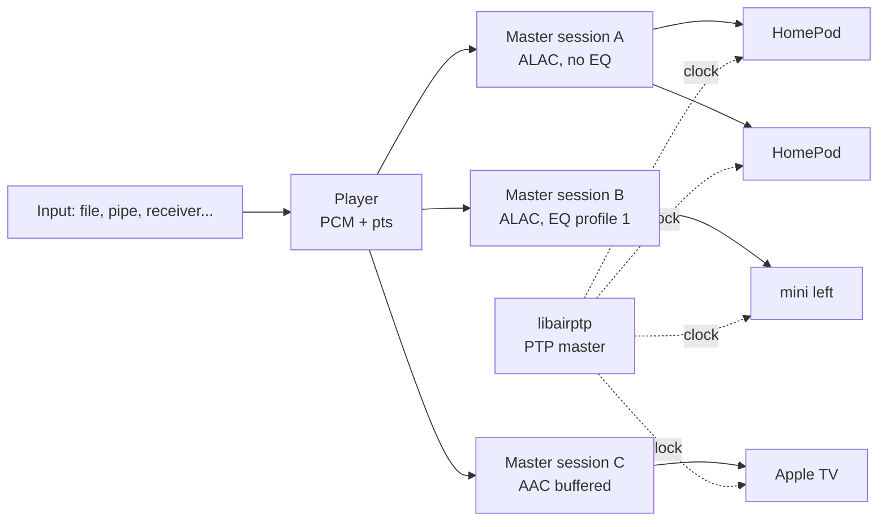

# AirPlay 2 sender (TX)

This page covers how OwnTone streams to AirPlay 2 speakers such as HomePods,
HomePod minis and Apple TVs. It also covers the additions in this fork:
buffered audio, per-speaker EQ and crossover, and performance counters. For
everyday setup of AirPlay speakers, see [AirPlay](../audio-outputs/airplay.md).

The receiving side, where OwnTone acts as a speaker, is described in
[AirPlay 2 receiver (RX)](receiver.md).

## Overview



The player produces PCM, and each write is stamped with the time it must be
audible. AirPlay groups speakers into **master sessions**. A master session
owns one encoder and one RTP stream, and every speaker in it gets the same
packets. Speakers share a master session only when all of these match:

- The audio quality: sample rate, bits and channels
- PTP or NTP timing
- Realtime or buffered transport
- The EQ profile

All master sessions are timed from the same player timestamps. Speakers on
different sessions therefore stay in sync with each other, even when they use
different transports or EQ.

OwnTone is the PTP master for its speakers. libairptp serves a clock that is
the same as `CLOCK_MONOTONIC`, which is also the player's clock, so timestamps
need no conversion. The speakers OwnTone serves its clock to are listed on
**Settings > Performance** with the time each was last heard from.

## Transports

| | Realtime (default) | Buffered |
|---|---|---|
| Stream type | 96 | 103 |
| Codec | ALAC, lossless | AAC-LC 44.1 kHz, lossy |
| Carried over | UDP | TCP |
| Timing | Sync packets | `SETRATEANCHORTIME` |
| Lost packets | Speaker asks for a resend | TCP handles it |
| Latency | About 2 s, fixed | Set by `start_buffer_ms` |
| Selected by | Speaker format `alac` | Speaker format `aac` |

Buffered audio is chosen per speaker by setting its format to `aac`, in the web
interface or with `PUT /api/outputs/{id}`. It is used only if the speaker
advertises buffered audio and PTP. Otherwise OwnTone logs it and falls back to
realtime.

### Buffered audio in detail

The PCM is encoded to AAC-LC in frames of 1024 samples. Each packet is sent on
the speaker's data connection with a 2-byte big-endian length in front:

- **Header bytes 1 to 3** hold the marker bit, which is always set, and a 23-bit
  sequence number.
- **Header bytes 8 to 11** hold the SSRC `0x16000000`, which tells the speaker
  the format is AAC-LC at 44.1 kHz.
- **The payload** is encrypted with ChaCha20-Poly1305 using the stream key when
  the speaker supports it. The nonce comes from the sequence number.

Buffered speakers get no sync packets. OwnTone instead sends
`SETRATEANCHORTIME`, which ties one RTP time to one PTP time:

```text
rtpTime         = pos - offset_samples + 1024
networkTimeSecs = player timestamp, seconds
networkTimeFrac = player timestamp, nanoseconds as a 64-bit binary fraction
```

`pos` is the position in the player's PCM that must be audible at that
timestamp. The 1024 makes up for the one-frame delay of ffmpeg's AAC encoder.
`offset_samples` comes from the speaker's `offset_ms`, which can be set per
speaker in the JSON API.

On pause, OwnTone sends `FLUSHBUFFERED` with `flushUntilSeq` set to the next
sequence number. The speaker discards its buffer and forgets the anchor. On
resume the session goes back to connected and a new anchor is sent.

## Speaker EQ and crossover

Each AirPlay speaker can have its own profile, applied to a copy of the PCM
before it is encoded. This makes setups like these possible:

- **A HomePod pair as subwoofer.** A low pass at 120 Hz keeps only the bass.
- **Two minis as side speakers.** A high pass at 120 Hz on both, with one
  playing the left channel and the other the right.
- **A tone adjustment.** For example a bass boost with the preamp lowered to
  avoid clipping.

### Processing chain


| Stage | Detail |
|---|---|
| Channel routing | `stereo`, `left` or `right` on both outputs, `mono` as (L+R)/2, or `swap` |
| Preamp | -24 to +12 dB |
| Bands | 60 Hz low shelf, peaking at 230 Hz, 910 Hz and 3.6 kHz, 14 kHz high shelf. Each -12 to +12 dB |
| High pass and low pass | Linkwitz-Riley 24 dB per octave, built from two Butterworth biquads. 20 Hz to 20 kHz, or 0 for off |
| Clipping | Samples beyond 16 bits are clipped and counted |

The filters are RBJ cookbook biquads in transposed direct form II with
double-precision state. Peaking bands use a Q of 0.9. A Linkwitz-Riley
crossover is -6 dB at its corner frequency, so a low pass and a high pass at
the same frequency sum flat.

A neutral or disabled profile is skipped entirely, and such a speaker shares
the normal stream. EQ needs 16-bit audio. With any other bit depth, OwnTone
logs it and plays the speaker without EQ.

### Changing a profile while playing

Profiles are stored per speaker in the database's admin table under
`dsp_profile_<id>`. Every save increases a generation counter, which the
AirPlay output checks on each write.

- **If every speaker on the master session wants the new profile,** the filters
  are updated in place. The filter state is kept, so there is no click.
- **If the speakers on the session disagree,** the change applies when that
  speaker's session is next set up. Deselect the speaker and select it again to
  apply it at once.

### Web interface

**Settings > Speaker EQ** has a slider per band, the preamp, the crossover and
channel routing for each AirPlay speaker. It also has these presets:

| Preset | Effect |
|---|---|
| Flat | All bands 0 |
| Bass boost | 60 Hz +6 dB, 230 Hz +2 dB, preamp -6 dB |
| Bass only | Low pass 120 Hz |
| Side left | High pass 120 Hz, left channel |
| Side right | High pass 120 Hz, right channel |
| Off | Disabled |

### JSON API

`GET /api/outputs/{id}/eq` returns the profile:

```json
{
  "enabled": true,
  "preamp_db": -6.0,
  "bands": [
    { "freq": 60, "type": "lowshelf", "gain_db": 6.0 },
    { "freq": 230, "type": "peaking", "gain_db": 2.0 },
    { "freq": 910, "type": "peaking", "gain_db": 0.0 },
    { "freq": 3600, "type": "peaking", "gain_db": 0.0 },
    { "freq": 14000, "type": "highshelf", "gain_db": 0.0 }
  ],
  "highpass_hz": 0,
  "lowpass_hz": 0,
  "channels": "stereo"
}
```

`PUT /api/outputs/{id}/eq` saves a profile in the same format and returns
`204 No Content`. The body replaces the whole profile, and missing fields take
their defaults. Send `"enabled": true`, because the default is off. `bands` may
also be a plain array of five gains. Values out of range are clamped, and gains
are stored in steps of 0.1 dB. A high pass at or above the low pass is rejected with `400 Bad Request`, because
it would mute the speaker.

```shell
curl -X PUT "http://localhost:3689/api/outputs/123456/eq" \
  -d '{"enabled": true, "lowpass_hz": 120}'
```

## Monitoring

**Settings > Performance** polls `GET /api/stats` every 2 s. It shows rates
worked out from the difference between two polls. The reply has these parts:

| Object | Content |
|---|---|
| `process` | PID, uptime, CPU time and memory of OwnTone |
| `host` | Load averages, CPU count and memory |
| `player` | State, volume, and counters for starts, underruns, flushes and read errors |
| `speakers` | The speaker list, as in `GET /api/outputs` |
| `outputs` | Counters per speaker, keyed by speaker ID |
| `ptp` | OwnTone's clock ID and the speakers it serves, with when each was last heard |
| `receiver` | The AirPlay receiver, see [Monitoring](receiver.md#monitoring) |

Counters only ever increase. These are the counters per speaker:

| Counter | Meaning |
|---|---|
| `packets`, `bytes` | Audio sent |
| `send_errors` | Packets that could not be sent, including partial sends |
| `retransmit_requests` | Resend requests from the speaker, realtime only |
| `retransmits` | Packets sent again |
| `retransmits_missed` | Requested packets that had already left the buffer of 1000 packets |
| `sessions`, `failures` | Sessions started and sessions that failed |
| `eq_clips` | Samples clipped by the speaker's EQ |
| `last_event`, `last_event_age_s` | What happened last, for example "session failed" |
| `transport` | "realtime ALAC/UDP" or "buffered AAC/TCP" |
| `eq_active`, `encoder_sessions` | Whether EQ runs for the speaker, and how many master sessions exist |

A realtime ALAC stream sends about 125 packets per second per speaker. Steady
growth in `retransmit_requests` points at Wi-Fi trouble near that speaker.
Growth in `retransmits_missed` means audio was lost. Rising `eq_clips` means
the preamp should come down.

## Speaker selection after a restart

When a speaker appears during playback, OwnTone normally leaves it off. With
pipe autostart, playback often starts right after OwnTone starts, before the
speakers are rediscovered, so the saved selection was lost. The new option
`speaker_rejoin = yes` in the `general` section lets a speaker that was
selected when last seen rejoin the playback.

## Code map

| File | Content |
|---|---|
| `src/outputs/airplay.c` | AirPlay 2 output: master sessions, realtime and buffered packets, anchors, EQ hook, counters |
| `src/dsp.c` | EQ, crossover, channel routing and profile storage |
| `src/stats.c` | Counters and process and host figures |
| `src/httpd_jsonapi.c` | `/api/stats` and `/api/outputs/{id}/eq` |
| `src/player.c` | Player counters and `speaker_rejoin` |
| `web-src/src/pages/PageSettingsEq.vue` | Speaker EQ page |
| `web-src/src/pages/PageSettingsPerformance.vue` | Performance page |

## Limitations

- **EQ only works on AirPlay 2 outputs.** Chromecast, local audio and the
  AirPlay 1 module are not processed.
- **Buffered audio is AAC-LC at 44.1 kHz only.**
- **Each distinct EQ profile adds an encoder.** That costs CPU, which the
  Performance page shows.
- **A shared stream can't change EQ for one speaker live.** See
  [Changing a profile while playing](#changing-a-profile-while-playing).
