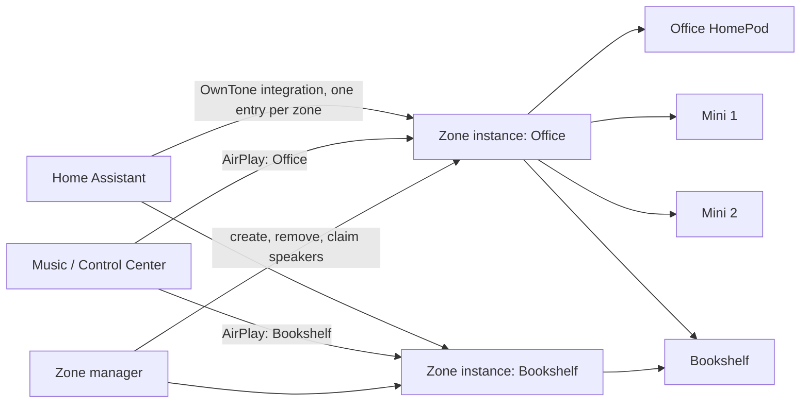

# Virtual speakers (design)

Status: proposal, nothing built yet.

## Goal

- No OwnTone speaker appears in AirPlay until you create a virtual speaker.
- A virtual speaker is a name plus one or more real speakers. One real speaker
  can belong to many virtual speakers, for example "Bookshelf" on its own, in
  "Office" and in "All speakers".
- Each virtual speaker is an independent zone with its own queue, so different
  virtual speakers can play different music at the same time.
- EQ can be set per speaker inside a virtual speaker, or for all of its
  speakers at once.
- Each virtual speaker appears in Home Assistant, and Home Assistant can start
  local music, radio and Spotify on it. Apple Music works only by remote
  controlling Music.app on a Mac.
- When a virtual speaker starts and one of its speakers is already playing in
  another zone, a per-virtual-speaker policy decides: **take over** (the other
  zone continues without that speaker) or **skip** (this zone plays without it).

## Why one OwnTone per zone

OwnTone has exactly one player session (`pb_session` in `src/player.c`) and one
input buffer (`input_buffer` in `src/input.c`). The JSON API, MPD, DAAP, the web
UI and the Home Assistant integration all assume a single queue. Making that
multi-zone means reworking most of the server.

Running one OwnTone instance per virtual speaker gets independent zones with
almost no player changes:

| Need | One instance per zone gives |
|---|---|
| Own queue and source | Each instance has its own player |
| Own AirPlay name | Each instance runs the native receiver with the virtual speaker's name |
| EQ per speaker per zone | EQ profiles are stored per instance, so "Bookshelf" can sound different alone and in a group |
| Home Assistant | One OwnTone integration entry per instance, so one media player each |
| Local music, radio, Spotify | Already built into every instance |

The cost is one process per virtual speaker, roughly 50 to 100 MB of memory
each. Each instance needs its own IP address, because the AirPlay 2 sender's
PTP clock binds UDP 319 and 320 and every instance advertises its own mDNS
services. A container per instance on a macvlan network does both.

## Parts

- **Zone manager.** A small service with its own web page and API. It stores the
  virtual speakers (name, member speakers, policy, EQ), creates and removes one
  zone instance per virtual speaker, and keeps a table of which zone holds which
  speaker. With no virtual speakers there are no instances, so nothing appears
  in AirPlay.
- **Zone instance.** OwnTone from this fork, in its own container. Its config is
  generated by the manager: the receiver name, which speakers it may use (all
  others excluded), the shared music folder, and a manager URL.
- **Speaker claims.** Before an instance starts playback it asks the manager to
  claim its speakers. With take over, the manager tells the zone that holds a
  speaker to deselect it, and that zone keeps playing on the rest. With skip,
  the busy speaker is left out of this zone. This is the only player change:
  one call to the manager when playback starts.
- **EQ for all speakers.** The EQ page gets an "apply to all speakers" action
  next to the per-speaker controls.

## Order of work

1. **Finish the native receiver.** (Realtime playback done, see
   [the receiver](receiver.md#realtime-audio-packets).) Play realtime streams (type 96), which carry
   system audio and video. This replaces Shairport Sync, and the receiver plays
   on the sender's timeline, which fixes lip sync and sync with the Mac's own
   speakers properly instead of with a fixed offset. Turn the receiver off by
   default.
2. **Zone instance image.** A container image of this fork with a config
   template.
3. **Zone manager.** Create and remove virtual speakers, start and stop
   instances, store members and policy.
4. **Speaker claims.** Take over or skip when a speaker is busy.
5. **EQ for all speakers.** The UI action, and copying member EQ into a new zone.
6. **Home Assistant.** Add each zone as an OwnTone integration entry, and check
   that play media with local music, radio and Spotify works on each one.
7. **Bookshelf speaker.** The Pi as a speaker that zones can use.

## Open questions

- A speaker on the Pi has to advertise AirPlay for zones to find it, so the Mac
  will list it too, just as it already lists the HomePods. Hiding it from the
  Mac would need a non-AirPlay link between the zones and the Pi.
- Spotify needs a login per instance, and Spotify Connect allows one active
  stream per account, so two zones cannot play Spotify from the same account at
  the same time.
- Apple Music from Home Assistant depends on remote controlling Music.app. One
  Mac can only play one Apple Music stream, so only one zone can play Apple
  Music at a time.
